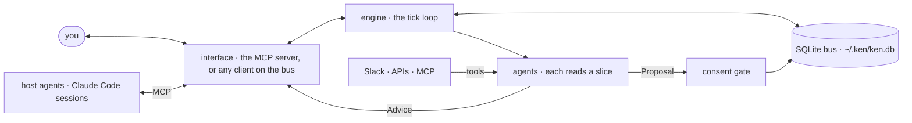

# Architecture

How Ken is put together, for someone about to change it. If you want to *use* Ken, read the
[README](README.md); if you want to *extend* it with a plugin, read [AGENTS.md](AGENTS.md).
This is the map of the machine itself.

## One idea

The engine is one process looping over one **SQLite bus** (`~/.ken/ken.db`). Data comes in
through agents' own tools or through the MCP server, is proposed into the bus through the gate,
and agents read a slice of it and speak. The MCP server (`ken-mcp`, stdio or HTTP) is the only
front door. There is no queue and no second store — the file *is* the system.

## The pieces

| Module | Role |
|---|---|
| `engine.py` | The tick loop. Each tick: pump the inbox → run scheduled + message-triggered agents → fire due reminders. An approved `act:` is dispatched back to its agent here. |
| `db.py` | The bus: schema + access. `configure()` sets the home (`~/.ken`, or `KEN_HOME`). |
| `contracts.py` | The shared vocabulary: `Task`, `Event`, `StructuredEntry`, `Provenance`, and the interface seam (`Renderable`, `Action`). |
| `agents/` | The agent base + Kip, the engine's built-in assistant agent. An agent declares a `slice` + `triggers` and returns `Advice` / `Proposal` / `None`. |
| `consent/` | The write path. An agent's `Proposal` is judged by the gate (`gate.py`) — keep / collapse / conflict — before it becomes a task, event, or belief. An `act:` proposal always cards and never writes; on Yes the engine hands it back to the agent. A `batch:` proposal (hydrate) skips the judge and cards once; on Yes the gate applies keep / edit / drop per item in one transaction. |
| `captures.py` | The typed writes (add/complete/discard/reschedule/schedule/assign/link task, log event, remember, forget) plus `hydrate` — one module, two callers (kip's tool loop and the MCP tools). Each proposes through the gate and returns the TRUE outcome. A hydrate batch into an empty namespace skips the judge and raises one card. |
| `maintain.py` | The maintainer: what the engine does while nobody is talking to it. Two daily passes, each a card: "done?" on a task reported on but still open, "still real?" on a task a week overdue. A No is remembered. One audit row per pass. Events carry an `until`: past it they leave reads, never the table. |
| `evals.py` | `ken eval reconcile` (real tiers) and `ken eval context` (deterministic); cases in `engine/evals/*.jsonl`. |
| `mcp_server.py` | The MCP server: reads hit the store; every write posts to the inbox and waits for the engine's reply, with the ids of the cards it raised. |
| `tools/` | Tools an agent calls mid-reasoning (deterministic reads of our own memory). |
| `capabilities.py` | Builds the live read/write/publish handles (`ctx.memory`, `ctx.propose`, `ctx.view`) from an agent's slice, so the agent module never imports the store or gate. |
| `memory/` | Read models over the bus — the slice preload and the live scoped reader. Records link to each other in one table (`links`: src, dst, a closed `rel` list); `get_context` follows exactly one hop, both directions. Not a graph. |
| `registry.py` | Discovery. Finds concrete `Agent` subclasses in the built-in package **and** in `~/.ken/agents`, isolating each file so one bad drop-in never drops the rest. |
| `llm.py` | The model client + tier→model mapping (`fast` / `reasoning`), OpenAI-compatible. |
| `conversation/` | The message bus seam (`inbox`/`outbox`) between an interface and the engine. |
| `rank.py` | An optional ranker (OpenAI Decisions): one calibrated score per item, injected into agents that accept `rank`. |
| `app.py` | Wiring: builds the engine, injects `llm`/`judge`/`rank`/`config` by `__init__` signature, creates `~/.ken/agents`. |
| `schedule.py`, `config.py`, `util.py` | Cron matching; the `~/.ken/config.yaml` reader; time/id helpers. |

**Task state.** A task has an `owner` (empty = the user, else a `people.<slug>` record or the
name as given; `assign_task` moves it) and may wait on other tasks (`link_tasks`, table
`task_deps`; rows carry `depends_on` and `blocked` while one is open; cycles are refused).
`tasks(status=open|done|dropped|all)` and `events(since, until)` read history without a word
search. Every direct write takes an optional `at` = when the change happened; a task keeps
`changed_at` (a record its `updated_at`), and a write whose `at` is older returns `stale` and
changes nothing, so a late, old update never wins.

## The two invariants

- **Agents advise; they never write.** The only write path is a `Proposal` through the consent
  gate. This is what keeps a bad or hostile agent from silently corrupting memory.
- **Nothing is believed without provenance.** Content another person wrote (a Slack message)
  is `WORLD` and always cards; the user's own words fast-track. The one execution Ken does,
  an `act:`, happens only after a tap, in the proposing agent's own code.

## The interface seam

The engine is interface-agnostic. It talks to a front end only through the `inbox`/`outbox`
tables on the bus:

- **MCP** (`mcp_server.py`) — `ken-mcp`, stdio or HTTP. Reads hit the store; every write posts to the
  inbox and waits for the engine's reply. Consent cards ride back to the calling agent.
- **Terminal** — `ken cards` / `ken decide` answer a card without any client.
- **Push** — `ken push` (from a 09:00 scheduler) or `GET /pending` delivers the open cards as one short message; a Claude routine can call `pending()` the same way. The engine itself never pushes.
- **Headless HTTP** — the engine runs with no terminal; any host can drive it over a generic HTTP
  interface (`ken-mcp --http`, `POST /`) that writes to the inbox and reads the reply from the outbox.
  Same engine, different front.

This is why the codebase never names a specific deployment: a new interface is just another
reader of the outbox and writer of the inbox. The MCP server (`ken/mcp_server.py`) is the worked example: it posts text to the inbox and
waits for the reply, running no engine of its own.

## Outside agents

Most agents do not run inside the engine. Any MCP client is an agent: Claude Code, Codex,
Hermes, a script on a schedule. It reads and writes Ken through the MCP server. An agent that
uses its own agent token (`http.agent_tokens`) raises a card for every write, so the user decides.

## Where state lives

Everything is under `~/.ken/` (override with `KEN_HOME`): `ken.db` (the bus), `config.yaml`
(keys, model tiers, HTTP tokens), `state/` (agent-writable config buckets), and your drop-in
`agents/`. Nothing
else, nowhere else. Delete the directory and Ken is gone without a trace.
