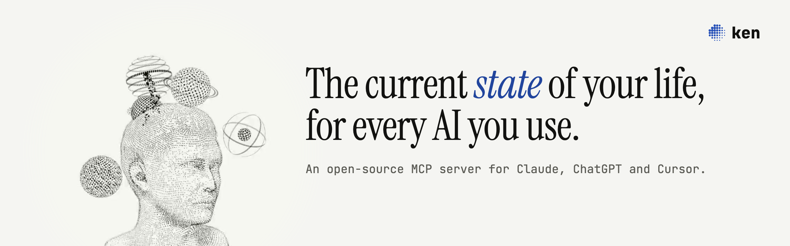
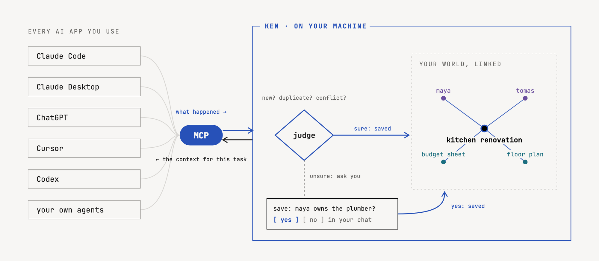
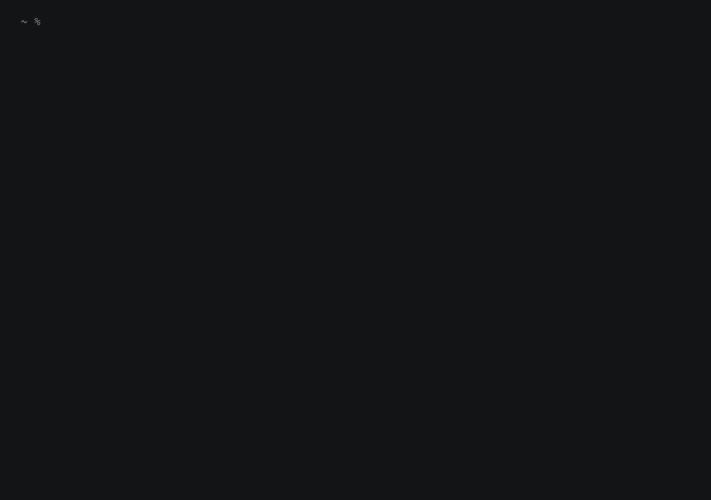
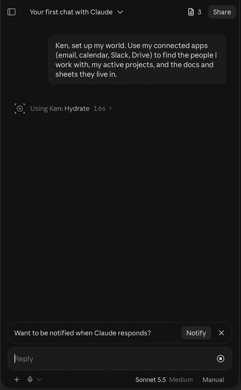
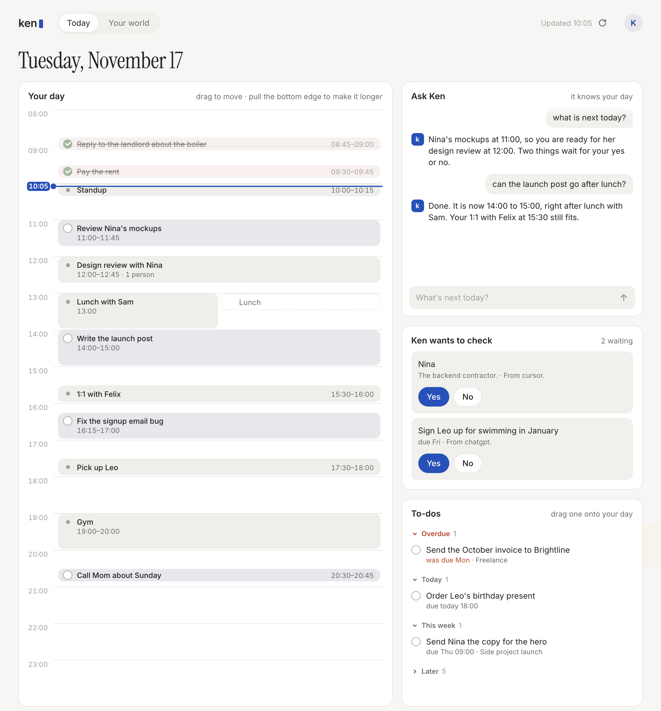
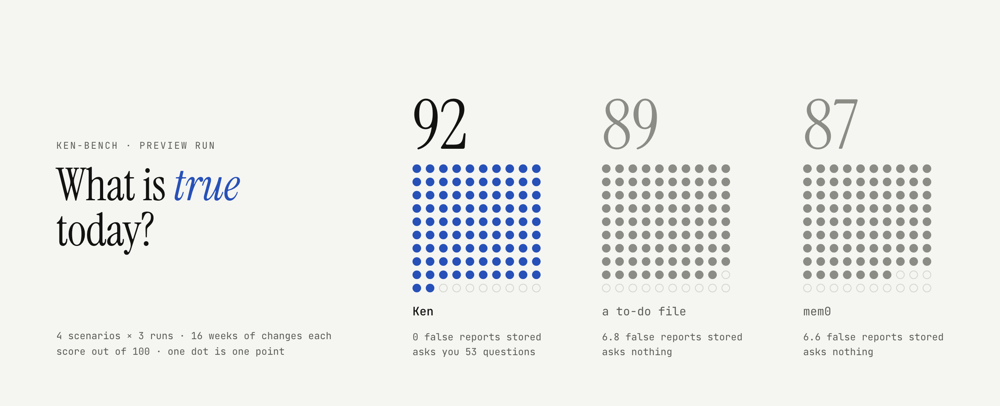

<picture>
  <source media="(prefers-color-scheme: dark)" srcset=".github/assets/header-dark.png">
  
</picture>

<p align="center">
  Ken is a self-hosted MCP server that keeps the current state of your life: one linked record of
  your tasks, people, projects and preferences, shared by every AI app you use. Not what was said,
  but what is true now. We call that record "your world".
  One SQLite file, Python, alpha. It uses a model for its checks: OpenAI, any OpenAI-compatible API,
  a local model, or your Claude Code login.
</p>

<p align="center">
  <a href="https://github.com/kenning-labs/ken/actions/workflows/ci.yml"></a>
  <a href="LICENSE"></a>
  
</p>

<p align="center">
  <a href="#get-started"><b>Get started</b></a> &nbsp;·&nbsp;
  <a href="#ken-cloud">Ken Cloud</a> &nbsp;·&nbsp;
  <a href="#benchmark-preview">Benchmark</a> &nbsp;·&nbsp;
  <a href="#faq">FAQ</a> &nbsp;·&nbsp;
  <a href="ARCHITECTURE.md">How it works</a> &nbsp;·&nbsp;
  <a href="https://github.com/kenning-labs/ken/discussions">Discussions</a>
</p>

<br>

<picture>
  <source media="(prefers-color-scheme: dark)" srcset=".github/assets/diagram-dark.png">
  
</picture>

## What your agent receives

Over a few chats you told Claude about the kitchen renovation; on Monday, that the plumber sent a quote. On Tuesday, you ask any agent, in any app, to
work on *"approve the quote from Tomas for the kitchen renovation"*. The task names only Tomas and
the renovation. Ken adds the rest through the links (trimmed):

```json
{
  "task": "approve the quote from Tomas for the kitchen renovation",
  "related": [
    {"kind": "person",  "name": "tomas",
     "why": "named in the task",
     "note": "The plumber; sent a quote on Monday."},
    {"kind": "project", "name": "kitchen renovation",
     "why": "named in the task",
     "note": "New kitchen by December; budget 18k EUR."},
    {"kind": "person",  "name": "maya",
     "why": "linked: maya is a member of kitchen renovation",
     "note": "Your partner; owns the plumber question."},
    {"kind": "asset",   "name": "floor plan",
     "why": "linked: floor plan is part of kitchen renovation",
     "note": "The kitchen floor plan."}
  ],
  "last_report": "Maya asked Tomas to keep the old sink"
}
```

The agent starts with the budget, who owns the plumber question, the floor plan and the last thing
that happened. You typed none of it into this chat. Each item also carries the evidence it rests on
(left out above to keep it short).

## What Ken stores

| | Built-in chat memory | Ken |
|---|---|---|
| **What it keeps** | notes from past chats | the current state: open, done, who owns what, what waits on what |
| **Old facts** | can sit next to new ones | replaced; a judge catches duplicates and contradictions |
| **Structure** | flat notes | people, projects, documents (`asset` records) and tasks, linked |
| **Who decides** | the app saves what it wants | a judge checks every write; you decide the unsure ones |
| **Which apps** | that one app | every MCP app reads and writes the same world |
| **Where** | the vendor's cloud | one SQLite file on your machine; write text goes to the model you choose |

What your own apps send (Claude Code on your machine, or any client with your own token) is saved
after the judge checks it for duplicates and conflicts. Ken asks you with a **card**, in the chat you
are already in, when a write would change an existing record, when the judge is unsure, when an app
saves its own guess rather than your words, or when the write comes from an agent with its own token.

## Get started

Rather not install anything? See [Ken Cloud](#ken-cloud).

```bash
brew install uv     # skip if you have uv. Linux: curl -LsSf https://astral.sh/uv/install.sh | sh
uv tool install 'ken-engine[mcp] @ git+https://github.com/kenning-labs/ken#subdirectory=engine'
ken init
```

`ken init` asks three things: which model Ken uses, whether to add Ken to Claude Code, and whether
to run it in the background. Then it tells you what is ready.

<p align="center">

</p>

<details>
<summary><b>Let your agent install it</b></summary>

Paste this into Claude Code, Codex or another coding agent:

```text
Install Ken, a local MCP server, from https://github.com/kenning-labs/ken (README, "Get started"):
1. If `uv --version` fails, install uv: `brew install uv` on macOS with Homebrew, otherwise
   `curl -LsSf https://astral.sh/uv/install.sh | sh`.
2. uv tool install 'ken-engine[mcp] @ git+https://github.com/kenning-labs/ken#subdirectory=engine'
3. Ask me which model Ken should use: my Claude Code login, or an OpenAI API key (never print a key).
   Then run `ken init --claude-code --add-to-claude --service`, or `ken init --api-key <key>
   --add-to-claude --service`.
4. Run `ken status` and `claude mcp list`. Tell me whether the engine is live and which server name
   reaches it, then what to say to start and how to undo the install.
```

If your agent may not change Claude Code's own settings, `ken init` prints the `claude mcp add`
command for you to run.
</details>

<details>
<summary><b>More about the install:</b> the model, other setups, running Ken by hand</summary>

- **uv** installs Ken and fetches Python 3.11 or newer if you don't have it. After installing uv,
  open a new terminal. After the first PyPI release, the install becomes `uv tool install 'ken-engine[mcp]'`.
- **The model** checks what your apps write and reads plain-text notes: an OpenAI key, your Claude Code
  login, another OpenAI-compatible API, or none for now. Without a terminal, pass it as a flag:
  `ken init --claude-code`, `--api-key KEY` (with `--base-url URL`), or `--no-model`.
- **Your data** is in `~/.ken`, private to you.
- **Claude Code:** if it already has a server named `ken` (for example Ken Cloud), `ken init` keeps it
  and adds this engine as `ken-local`; turn the other one off in `/mcp`.
- **The background service** starts at login (launchd on macOS, a systemd user service on Linux).
  Without it, run `ken` in a terminal and keep it open. Later: `ken service status`,
  `ken service uninstall`, or `ken service install`. `ken status` shows whether the engine is live;
  `ken --version` shows the version.
- Apps talk to the engine through `ken-mcp`. Writes wait for the engine: with the engine stopped, a
  write returns outcome `queued` and applies when it starts, so do not send it again.
</details>

Then, in Claude (Code or Desktop), say **"set up my world"**. Claude reads what it can reach (connected mail,
calendar, files) and proposes your people, projects and documents in batches. Ken saves nothing
until you say yes.

<p align="center">

</p>

**Connecting an agent.** Any MCP client works: Claude Code, Codex, a script on a schedule. Give each
agent its own token under `http.agent_tokens`, and every write from it becomes a card for you. Only
your own token can answer a card.

<details>
<summary><b>When Ken calls a model,</b> and what changes without an OpenAI key</summary>

The agent that calls Ken does most of the work: it reads your mail or your code, decides what
matters, and sends Ken structured updates. Ken itself calls a model for a few jobs:

| Job | Model (OpenAI default) |
|---|---|
| Decide whether a write is new, a duplicate or a conflict; rank your undated tasks | [OpenAI Decisions API](https://developers.openai.com/api/docs/guides/decisions) (`gpt-6-luna`) |
| Judge a write when Decisions cannot | `gpt-5.6-luna` |
| Turn a free-text report (`tell`) into the right writes | `gpt-5.6-terra` |

| You have | What Ken does |
|---|---|
| An OpenAI key | everything above; most calls cost a fraction of a cent, a `tell` report more |
| A Claude Code login | the same jobs through `claude -p`; Decisions is off |
| No model | stores what agents send with no duplicate or conflict check, and cannot read `tell` reports; agent-token writes still become cards |

Turn Decisions off with `decisions: {enabled: false}`; other models are under **Models** below.

</details>

<details>
<summary><b>Claude Desktop</b></summary>

Add Ken to `claude_desktop_config.json` (Settings → Developer → Edit Config) and restart the app.
Use the full path that `which ken-mcp` prints:

```json
{
  "mcpServers": {
    "ken": { "command": "/full/path/to/ken-mcp" }
  }
}
```

</details>

<details>
<summary><b>Apps that need a URL:</b> claude.ai, ChatGPT, another machine, your phone</summary>

Set a token in `~/.ken/config.yaml`, then serve Ken over HTTP:

```yaml
http:
  host: 127.0.0.1
  port: 8765
  token: "a-long-random-secret"
```

```bash
ken-mcp --http
```

Put it behind a tunnel or reverse proxy you control (ngrok, Cloudflare Tunnel, Caddy). Then
connect with `https://<your-host>/mcp` and the header `Authorization: Bearer <token>`:

```bash
claude mcp add --transport http ken https://<your-host>/mcp --header "Authorization: Bearer <token>"
```

An app that cannot send a header can use `https://<your-host>/t/<token>/mcp`. The token is the
only lock, so treat the URL like a password. Ken refuses to listen beyond localhost without a token.

</details>

<details>
<summary><b>Models:</b> OpenAI, any OpenAI-compatible API, a local model, or your Claude Code login</summary>

All settings sit under `llm:` in `~/.ken/config.yaml`.

| Setup | Under `llm:` |
|---|---|
| OpenAI (default) | `api_key: sk-...` |
| Any OpenAI-compatible API | `base_url: https://.../v1`, `api_key: ...`, `tiers: {fast: <model>, reasoning: <model>}` |
| Local model (Ollama) | `base_url: http://localhost:11434/v1`, `api_key: ollama`, `api_style: chat`, `tiers: {fast: llama3.1}` |
| Your Claude Code login | `provider: claude-code` (default tiers `sonnet` and `opus`) |

`api_style: chat` is for a server with no `/v1/responses` endpoint. The Claude Code provider runs
`claude -p` for each call, so answers take a few seconds longer. Use it on your own machine or your
own household server, not for a public service. More options are in
[engine/config.example.yaml](engine/config.example.yaml).

</details>

<details>
<summary><b>Cards in the terminal</b> and a morning push</summary>

Your AI app shows each card in the chat. You can also answer from the terminal:

```bash
ken cards              # the open cards
ken decide <id> yes    # or: no
```

`ken push` sends your open cards to any URL that takes a text body, for example an
[ntfy](https://ntfy.sh) topic. Set `push.url` in the config and run `ken push` each morning from
cron or launchd. Nothing waiting means nothing sent. Try it with `ken push --dry-run`.

</details>

<details>
<summary><b>The MCP tools</b></summary>

| Tool | What it does |
|---|---|
| `tasks`, `get_context` | open (or closed) tasks; everything that matters for one task, with the evidence for each item |
| `who_is`, `find`, `world`, `events` | one person or project, a search, your whole world, what happened in a date range (with `answers=true`, also your yes/no on cards; an agent sees only the answers to its own cards) |
| `add_task`, `complete_task`, `discard_task`, `reschedule_task`, `schedule_task` | task writes |
| `assign_task`, `link_tasks` | who does a task; which task waits on which |
| `log_event`, `remember`, `forget` | events, people, projects, preferences, facts |
| `tell` | a free-text report; Ken turns it into the right writes |
| `hydrate` | day zero: build your world in batches you confirm |
| `pending`, `decide` | the open cards, and your answer to one |
| `inbox`, `inbox_chat`, `inbox_apply`, `inbox_close` | what the Dreamer found overnight, and your answer |

Every write returns the real outcome and the ids of any cards it raised, so an agent has the facts
to tell you correctly what was saved.

</details>

## Ken Cloud

Rather not run it yourself? We run Ken for you: the same engine as this repo, on a small virtual
machine and disk of your own in Frankfurt (EU). Sign in with Google, paste one URL into Claude (or
ChatGPT, where custom connectors are on), and see your day and your world in a web app. Model calls are included, so you need no API
key. **[Get early access →](https://kenninglabs.com/?ref=github)**

<picture>
  <source media="(prefers-color-scheme: dark)" srcset=".github/assets/cloud-day-dark.png">
  
</picture>

| | Self-hosted | Ken Cloud |
|---|---|---|
| **Where Ken runs** | your machine | your own virtual machine and disk, Frankfurt (EU) |
| **Setup** | install, `ken init`, keep `ken` running | sign in with Google |
| **Model** | your OpenAI key, Claude Code login or a local model | included |
| **Connect claude.ai or ChatGPT** | a tunnel or reverse proxy you run | one URL |
| **Web app** (your day, your world) | not included; [build your own](DASHBOARD.md) | included |
| **Updates** | `uv tool upgrade ken-engine` | we deploy them |

What changes when we host it:

- **Where your world lives:** a 1 GB disk attached only to your machine. Accounts share the sign-in
  and the URL gateway, not the engine or the database.
- **Who can reach it:** your own token, and us as the operators of the machine. We do not read it
  unless you ask us to debug something.
- **Model calls:** the text of a write goes to OpenAI, under our account, so it can be judged.
- **Calendar:** if you link Google Calendar, the gateway keeps its token encrypted and reads today's
  events live for the web app. It stores no events.
- **Moving to self-hosting:** ask us, and we hand you your SQLite file to run with `ken`.

## Benchmark (preview)

<picture>
  <source media="(prefers-color-scheme: dark)" srcset=".github/assets/bench-dark.png">
  
</picture>

**A preview, and our own benchmark.** We wrote [ken-bench](https://github.com/kenning-labs/ken-bench)
for the job Ken is built for: keeping one person's current state right while it changes. Read it
as a check on that job, not as a neutral comparison.

Each scenario is 16 weeks of one person's life: 4 projects, about 25 tasks and about 137 changes,
written as chats, emails and Slack messages. Dates move, tasks get done in other words, and other
people report things that are not true. The same agent (DeepSeek V4.1 Flash) reports every day
into each system through that system's own tools. At 4 checkpoints we ask what is true today.
4 scenarios × 3 runs, on seeds we did not use while we built the benchmark. "Whole history" is no memory system at
all: the same model with every chat, email and Slack message in its prompt.

| Mean per run | Ken | whole history | to-do file | mem0 |
|---|---|---|---|---|
| Planted false values found in the store | **0** | n/a | 6.8 | 6.6 |
| Answers that repeat a planted false value | **0** | 1.8 | 1.8 | 1.3 |
| Answers that give an out-of-date value | 1.0 | **0** | **0** | **0** |
| **Current-state score**, all questions (0 to 1) | **0.92** | 0.87 | 0.89 | 0.87 |
| · Which tasks are open? | **0.90** | **0.90** | 0.75 | 0.84 |
| · Which tasks are due by a date? | **0.93** | 0.84 | 0.76 | 0.76 |
| · Is this task done? (asked in other words) | 0.97 | 0.85 | **0.99** | 0.89 |
| Yes/no questions put to the user in 16 weeks | 53 | 0 | 0 | 0 |

- **False reports stay out.** In 12 runs, no planted false value reached Ken's store. The to-do
  file and mem0 each stored about 7 and repeated 1 to 3 in answers.
- **The whole history in the prompt is not enough.** With everything in front of it, the same model scored 0.87 and
  repeated a planted false report in about 2 answers per run. It cannot tell which statement the user confirmed.
- **The overall gap is small.** Ken leads the to-do file by 0.03, and the to-do file is ahead on
  2 of the 4 scenarios. Most questions are easy for all three.
- **Ken pays with questions:** about 3 a week, and the user says no to 4 in 10.
- **Ken was wrong too.** It gave an old value about once per run, and in 6 of 12 runs it took an
  errand that someone posted to a whole channel as the user's task.
- mem0 is the open-source `mem0ai` 2.2.1. It is built for recall, not for this job.
- No cost numbers in this preview.

The full table, the method, the limits, the scenarios and every raw answer are in
[ken-bench](https://github.com/kenning-labs/ken-bench).

## Privacy

This is self-hosted Ken. For Ken Cloud, see [what changes when we host it](#ken-cloud).

- **Ken stores everything in `~/.ken/`**: one config file and one SQLite database, both private to
  you.
- **The text of a write goes to the model you configure** so it can be judged: OpenAI by default,
  your Claude Code login, or a local model that keeps it all on your machine.
- **Ken sends no telemetry.** Apart from those model calls, only `ken push` sends anything, and only
  if you turn it on.
- **Ken never reads your mail, chats or calendar itself.** Your agents read those with their own
  tools and send Ken the result: who is who, what was decided, what is due.
- **Agents you connect run with your permissions.** Connect only agents you trust; give each one its
  own token so its writes come to you as cards.

To remove Ken and everything it stored: `uv tool uninstall ken-engine && rm -rf ~/.ken`.

## FAQ

<details>
<summary><b>How is this different from Claude's or ChatGPT's own memory?</b></summary>

Their memory lives inside one app and one vendor. Ken is one world that every MCP app shares, it
is stored on your machine, and you approve what agents write. You can see and change everything it
holds.

</details>

<details>
<summary><b>How is this different from mem0, Zep or other memory libraries?</b></summary>

mem0 (OpenMemory) and Zep (Graphiti) also serve memory over MCP. mem0 updates and deletes facts as
they change; Graphiti keeps typed, time-aware facts in a graph. Ken differs in three ways: it tracks
task state (owner, status, deadline, what a task waits on), it holds uncertain and agent-token writes
for your approval, and it is one SQLite file with no vector store.

</details>

<details>
<summary><b>Why no embeddings or vector database?</b></summary>

Ken looks things up by the names and links you confirmed: the task names Tomas, Tomas works on the
kitchen renovation, the floor plan belongs to it. That is exact and explainable, and it fits in one
SQLite file. The trade-off: a lookup by name misses a synonym ("the plumber" does not find Tomas
unless a note says so). The agent that calls Ken usually knows the name.

</details>

<details>
<summary><b>Is it ready?</b></summary>

Alpha. We use it every day. Before 1.0, expect breaking changes to config keys and MCP tool
arguments; the database migrates forward on upgrade. How it works inside is in
[ARCHITECTURE.md](ARCHITECTURE.md).

</details>

---

<p align="center">
  <b>Questions and ideas:</b> <a href="https://github.com/kenning-labs/ken/discussions">Discussions</a> &nbsp;·&nbsp;
  <b>Bugs:</b> <a href="https://github.com/kenning-labs/ken/issues">Issues</a> &nbsp;·&nbsp;
  <b>Security:</b> <a href="SECURITY.md">SECURITY.md</a>
  <br><br>
  Contributions are welcome: read <a href="CONTRIBUTING.md">CONTRIBUTING.md</a> and the
  <a href="CODE_OF_CONDUCT.md">Code of Conduct</a>. Your first pull request asks you to accept the
  <a href="CLA.md">CLA</a> with one click. Changes are in <a href="CHANGELOG.md">CHANGELOG.md</a>.
  <br><br>
  Ken is licensed under the <a href="LICENSE">AGPL-3.0</a>. Made by Kenning Labs.
</p>
